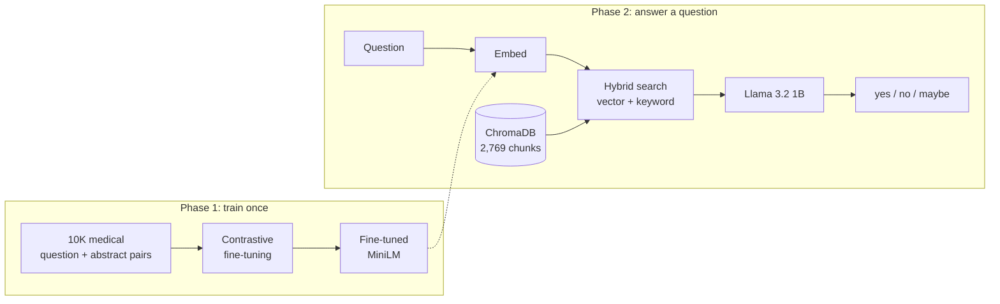
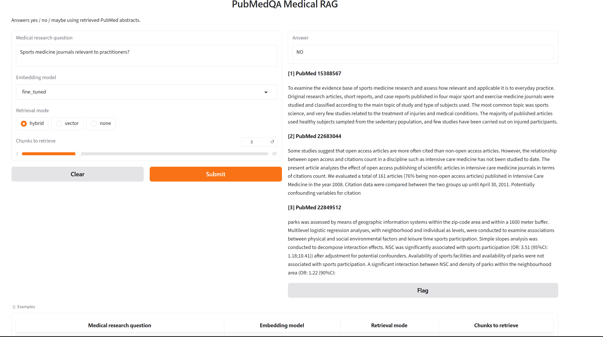

# Medical RAG on PubMedQA

**Does fine-tuning an embedding model on medical text help a RAG system find better evidence and give better answers?**

[](https://colab.research.google.com/github/akshayasiva/pubmedqa-medical-rag/blob/main/PubMedQA_Medical_RAG_from_scratch%20jupyter.ipynb)


---

## TL;DR

- Built a medical question-answering system that searches **1,000 PubMed abstracts** and answers **yes / no / maybe**.
- **Fine-tuned** a sentence-embedding model on 10,000 medical question–abstract pairs. It found the correct abstract first **97.7%** of the time, up from **96.7%**.
- Found that the **bottleneck is the small LLM, not retrieval**: the right evidence reached the model 98% of the time, but Llama 3.2 1B answered "no" to every question.

---

## How it works



| Step | What happens |
|---|---|
| 1. Chunk | Each abstract is cut into 100-word pieces with a 20-word overlap |
| 2. Fine-tune | MiniLM learns to place each medical question close to its own abstract |
| 3. Store | Chunks are turned into embeddings and saved in ChromaDB |
| 4. Search | The question is matched by meaning (vector), exact words (BM25), or both (hybrid) |
| 5. Answer | Llama reads the top 3 chunks and replies with one word |
| 6. Evaluate | Retrieval and answers are scored against expert labels |

---

## Results

### Retrieval: did it find the right abstract? (1,000 questions)

| Search method | Found first (Hit@1) | Ranking score (MRR@10) |
|---|---|---|
| Keyword only (BM25) | 94.0% | 0.959 |
| Vector, general model | 96.7% | 0.977 |
| **Vector, fine-tuned model** | **97.7%** | **0.984** |
| Hybrid, general model | 97.3% | 0.981 |
| Hybrid, fine-tuned model | 97.3% | 0.981 |

### Answers: was the final answer correct? (200-question sample)

| Setup | Accuracy | Right evidence given to LLM |
|---|---|---|
| LLM only, no retrieval | 31.5% | – |
| RAG + general embeddings | 31.5% | 98% |
| RAG + fine-tuned embeddings | 31.5% | 98% |
| *Always answer "yes"* | *55.2%* | – |

### Key findings

1. **Fine-tuning helped retrieval.** Every metric improved. The fine-tuned model was the best at ranking the correct abstract first.
2. **Retrieval is near its ceiling.** Even the general model scored 96.7%, because PubMedQA questions reuse words from their own abstracts.
3. **Hybrid search didn't add value here.** Keyword search was the weakest method, so mixing it in slightly lowered the fine-tuned model's top-1 score.
4. **The LLM is the bottleneck.** Llama 3.2 1B answered "no" to all 200 questions in every setup, so its 31.5% accuracy equals the share of "no" questions. Better retrieval cannot improve answers until this step is fixed.

<details>
<summary><b>Detailed results (click to expand)</b></summary>

**Embedding model only** (InformationRetrievalEvaluator, chunk level)

| Metric | General | Fine-tuned | Change |
|---|---|---|---|
| Accuracy@1 | 0.967 | 0.977 | +0.010 |
| Accuracy@5 | 0.988 | 0.991 | +0.003 |
| Accuracy@10 | 0.993 | 0.994 | +0.001 |
| Recall@5 | 0.800 | 0.811 | +0.011 |
| Recall@10 | 0.852 | 0.861 | +0.010 |
| NDCG@10 | 0.850 | 0.861 | +0.011 |
| MRR@10 | 0.977 | 0.984 | +0.007 |
| MAP@10 | 0.782 | 0.796 | +0.014 |

**Retrieval setups** (abstract level)

| Setup | Hit@1 | Hit@5 | Hit@10 | MRR@10 |
|---|---|---|---|---|
| Keyword (BM25) | 0.940 | 0.982 | 0.984 | 0.959 |
| Vector, general | 0.967 | 0.991 | 0.994 | 0.977 |
| Vector, fine-tuned | 0.977 | 0.992 | 0.994 | 0.984 |
| Hybrid, general | 0.973 | 0.992 | 0.995 | 0.981 |
| Hybrid, fine-tuned | 0.973 | 0.992 | 0.996 | 0.981 |

**Answer accuracy by class**

| Setup | yes | no | maybe |
|---|---|---|---|
| LLM only | 0.0 | 1.0 | 0.0 |
| RAG + general | 0.0 | 1.0 | 0.0 |
| RAG + fine-tuned | 0.0 | 1.0 | 0.0 |

**Accuracy when the right abstract was / wasn't retrieved**

| Setup | Retrieved | Not retrieved |
|---|---|---|
| RAG + general | 0.321 | 0.0 |
| RAG + fine-tuned | 0.321 | 0.0 |

</details>

---

## Demo

A Gradio app lets anyone ask a question, choose the embedding model and search mode, and see the answer with its evidence.



For *"Are sports medicine journals relevant and applicable to practitioners and athletes?"*, the fine-tuned retriever ranked the source abstract (PubMed 15388567) **first** among 1,000 abstracts.

---

## Data

| | Rows | Used for |
|---|---|---|
| [PubMedQA](https://huggingface.co/datasets/qiaojin/PubMedQA) `pqa_unlabeled` | 61,249 | Fine-tuning (10,000 sampled) |
| [PubMedQA](https://huggingface.co/datasets/qiaojin/PubMedQA) `pqa_labeled` | 1,000 | Search corpus and test set |

- **Answer balance:** yes 55.2% · no 33.8% · maybe 11.0%
- **No data leakage:** none of the 1,000 test articles appear in the training data (checked by article ID).

---

## Tech stack

| Component | Tool |
|---|---|
| Embedding model | [all-MiniLM-L12-v2](https://huggingface.co/sentence-transformers/all-MiniLM-L12-v2), fine-tuned for 2 epochs |
| Fine-tuning | sentence-transformers, MultipleNegativesRankingLoss, batch size 32 |
| Vector database | ChromaDB (cosine similarity) |
| Keyword search | rank_bm25 |
| Hybrid search | Reciprocal Rank Fusion |
| LLM | [Llama 3.2 1B Instruct](https://huggingface.co/meta-llama/Llama-3.2-1B-Instruct) |
| App | Gradio |
| Compute | Google Colab, NVIDIA T4 GPU |

---

## Skills demonstrated

- Fine-tuning a transformer embedding model with contrastive learning
- Building a full RAG pipeline: chunking, embeddings, vector database, retrieval, LLM generation
- Vector, keyword and hybrid search
- Information-retrieval evaluation (Hit@K, MRR, NDCG, MAP)
- Experiment design: changing one variable at a time, baselines, leakage checks
- Error analysis: finding that the LLM, not retrieval, limits answer quality
- Building and sharing an interactive demo with Gradio

---

## Glossary

| Term | Meaning |
|---|---|
| **Embedding** | Text turned into a list of numbers so that similar meanings sit close together |
| **Fine-tuning** | Giving a pretrained model extra training on a specific topic |
| **Contrastive learning** | Training a model to pull matching pairs together and push non-matching ones apart |
| **RAG** | Retrieval-augmented generation: find evidence first, then let the LLM answer from it |
| **BM25** | Classic keyword search that scores exact word matches |
| **Hybrid search** | Combining vector and keyword search results |
| **Hit@1** | How often the correct abstract was ranked first |
| **MRR@10** | Average of 1 ÷ rank of the correct abstract (1st = 1, 2nd = 0.5, ...) |

---

## How to run

1. Click **Open in Colab** at the top.
2. Runtime → Change runtime type → **T4 GPU**.
3. Request access to [Llama 3.2 1B Instruct](https://huggingface.co/meta-llama/Llama-3.2-1B-Instruct) on Hugging Face.
4. Create a Hugging Face token and add it in Colab Secrets as `HF_TOKEN`.
5. Run all cells from top to bottom (about 45–60 minutes).

---

## Repository structure

```
pubmedqa-medical-rag/
├── README.md
├── PubMedQA_Medical_RAG_from_scratch jupyter.ipynb   # full notebook with outputs
├── pubmedqa_medical_rag_from_scratch.py               # plain Python version
├── requirements_text.txt                             # libraries used
├── retrieval_results.csv                              # retrieval scores for all 5 search setups
├── rag_predictions.csv                                # every answer from the evaluation
└── app_hybrid.png                                     # app screenshot
```

---

## Limitations

- **Small LLM:** Llama 3.2 1B collapsed to always answering "no", so answer accuracy doesn't yet reflect retrieval quality.
- **Easy retrieval setting:** each question's own abstract is in the corpus, which keeps retrieval scores high.
- **Scope:** one dataset, one random seed, and a 200-question sample for answer evaluation.

## Next steps

- Fix the answer step by scoring the likelihood of "yes", "no" and "maybe" or using a stronger LLM (e.g. Qwen2.5-3B-Instruct)
- Evaluate answers on all 1,000 questions
- Add a cross-encoder reranker and a biomedical embedding model (e.g. PubMedBERT)
- Deploy the app on Hugging Face Spaces

---

## Acknowledgements

- Based on *Domain-Specialized Embedding Learning for Medical RAG* by Vishwa Gosavi and Aswini Sivakumar ([repo](https://github.com/AswiniS94/PubMed_RAG_Vishwa_Aswini_CSI5130)). Re-implemented from scratch with ChromaDB, an LLM-only baseline, and a retrieval-vs-answer analysis.
- Jin et al., *PubMedQA: A Dataset for Biomedical Research Question Answering*, EMNLP 2019.

## Author

**Akshaya Sivakumar** · [LinkedIn](https://www.linkedin.com/in/akshaya-siva-kumar/) · [GitHub](https://github.com/akshayasiva)
