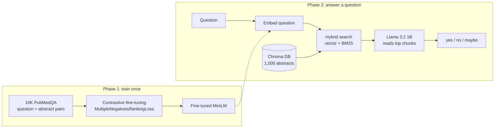

# Medical RAG on PubMedQA: Does a Fine-Tuned Embedding Model Give Better Answers?

[](https://colab.research.google.com/github/akshayasiva/pubmedqa-medical-rag/blob/main/PubMedQA_Medical_RAG.ipynb)

A retrieval-augmented generation (RAG) system that answers medical research questions with **yes / no / maybe**, using PubMed abstracts as evidence. The core experiment compares a general-purpose embedding model with the same model fine-tuned on medical question–abstract pairs, and measures the effect on both retrieval and final answer accuracy.

---

## Research question

> Does fine-tuning an embedding model on domain-specific (medical) text improve retrieval quality and answer accuracy in a RAG system?

**Why it matters:** LLMs can give confident but unsupported answers in medicine. RAG grounds answers in retrieved evidence, but it only works if retrieval finds the right documents. The embedding model drives retrieval, so this project isolates it as the single variable that changes.

---

## Pipeline



1. **Chunking:** each abstract is split into 100-word chunks with a 20-word overlap.
2. **Embedding:** chunks are embedded with either the baseline or the fine-tuned model and stored in ChromaDB (cosine similarity).
3. **Retrieval:** vector search, BM25 keyword search, or a hybrid of both using Reciprocal Rank Fusion (RRF).
4. **Generation:** Llama 3.2 1B Instruct answers using only the retrieved context, constrained to one word.
5. **Evaluation:** retrieval metrics (Hit@K, MRR@10) and end-to-end answer accuracy.

---

## Data

| Split | Rows | Used for |
|---|---|---|
| `pqa_unlabeled` | ~61,000 question–abstract pairs | Fine-tuning (10,000 sampled) |
| `pqa_labeled` | 1,000 expert-labeled questions | Vector DB corpus + evaluation |

- Source: [qiaojin/PubMedQA](https://huggingface.co/datasets/qiaojin/PubMedQA)
- **Leakage check:** training pairs whose `pubid` appears in the test set were removed before fine-tuning.
- **Answer balance (test set):** yes 55.2% · no 33.8% · maybe 11.0%
  - A model that always answers "yes" scores **55.2%**. That is the majority-class baseline to beat.

---

## Models and tools

| Component | Choice |
|---|---|
| Baseline embedding model | [`sentence-transformers/all-MiniLM-L12-v2`](https://huggingface.co/sentence-transformers/all-MiniLM-L12-v2) |
| Fine-tuned embedding model | Same MiniLM, fine-tuned for 2 epochs, batch size 32, in-batch negatives |
| Vector database | ChromaDB (in-memory, cosine) |
| Keyword search | `rank_bm25` (BM25Okapi) |
| Hybrid fusion | Reciprocal Rank Fusion, k = 60 |
| LLM | [`meta-llama/Llama-3.2-1B-Instruct`](https://huggingface.co/meta-llama/Llama-3.2-1B-Instruct), float16 |
| Interface | Gradio |
| Compute | Google Colab, NVIDIA T4 GPU |

---

## Results

**Corpus:** 1,000 abstracts → 2,769 chunks. **Leakage check:** 61,249 training pairs before and after filtering (zero overlap with the test set).

### 1. Embedding model only (InformationRetrievalEvaluator, chunk level, 1,000 questions)

| Metric | Baseline | Fine-tuned | Change |
|---|---|---|---|
| Accuracy@1 | 0.967 | 0.977 | +0.010 |
| Accuracy@5 | 0.988 | 0.991 | +0.003 |
| Accuracy@10 | 0.993 | 0.994 | +0.001 |
| Recall@5 | 0.800 | 0.811 | +0.011 |
| Recall@10 | 0.852 | 0.861 | +0.010 |
| NDCG@10 | 0.850 | 0.861 | +0.011 |
| MRR@10 | 0.977 | 0.984 | +0.007 |
| MAP@10 | 0.782 | 0.796 | +0.014 |

### 2. Retrieval setups (abstract level, 1,000 questions)

| Setup | Hit@1 | Hit@5 | Hit@10 | MRR@10 |
|---|---|---|---|---|
| Keyword (BM25) | 0.940 | 0.982 | 0.984 | 0.959 |
| Vector, baseline | 0.967 | 0.991 | 0.994 | 0.977 |
| **Vector, fine-tuned** | **0.977** | **0.992** | 0.994 | **0.984** |
| Hybrid, baseline | 0.973 | 0.992 | 0.995 | 0.981 |
| Hybrid, fine-tuned | 0.973 | 0.992 | **0.996** | 0.981 |

### 3. End-to-end answer accuracy (200-question sample, top-3 chunks, hybrid search)

| Setup | Accuracy | Unknown rate | Gold abstract in context |
|---|---|---|---|
| LLM only (no retrieval) | 0.315 | 0.0 | – |
| RAG + baseline embeddings | 0.315 | 0.0 | 0.98 |
| RAG + fine-tuned embeddings | 0.315 | 0.0 | 0.98 |
| *Always "yes" baseline (full test set)* | *0.552* | – | – |

**Per-class accuracy**

| Setup | yes | no | maybe |
|---|---|---|---|
| LLM only | 0.0 | 1.0 | 0.0 |
| RAG + baseline | 0.0 | 1.0 | 0.0 |
| RAG + fine-tuned | 0.0 | 1.0 | 0.0 |

### 4. Does better retrieval lead to better answers?

| Setup | Accuracy when gold abstract retrieved | Accuracy when not retrieved |
|---|---|---|
| RAG + baseline | 0.321 | 0.0 |
| RAG + fine-tuned | 0.321 | 0.0 |

### Key findings

- **Fine-tuning improved retrieval slightly but consistently.** Every metric went up: Accuracy@1 +1.0 point (96.7% → 97.7%), MRR@10 0.977 → 0.984, MAP@10 +1.4 points. Fine-tuned vector search was the best setup at rank 1.
- **The retrieval task is near its ceiling.** Even the general model finds the right abstract first 96.7% of the time, because PubMedQA questions reuse words from their own abstracts. That leaves little room for any model to improve.
- **Hybrid search did not beat fine-tuned vector search here.** BM25 alone was the weakest (Hit@1 0.940), so fusing it in slightly diluted the fine-tuned model's top-1 ranking (0.977 → 0.973) while helping the baseline model (0.967 → 0.973).
- **The LLM step is the bottleneck.** The right abstract reached the LLM 98% of the time, yet Llama 3.2 1B answered "no" to every question in every setup. Its 31.5% accuracy is simply the share of "no" questions in the sample, below the 55.2% "always yes" baseline. Better retrieval cannot help until the answer step is fixed (see Next steps).

---

## Demo


**Example:** *"Are sports medicine journals relevant and applicable to practitioners and athletes?"*
- Correct answer: **no**
- The fine-tuned hybrid retriever ranked the source abstract (PubMed 15388567) **first**.
- The app answered **no**, which matches, but the evaluation shows the 1B model answers "no" to every question, so this answer reflects that bias rather than reading the evidence.


---

## How to run

1. Click **Open in Colab** above.
2. Runtime → Change runtime type → **T4 GPU**.
3. Request access to [Llama 3.2 1B Instruct](https://huggingface.co/meta-llama/Llama-3.2-1B-Instruct) on Hugging Face.
4. Create a Hugging Face access token and add it in Colab Secrets as `HF_TOKEN`.
5. Run all cells top to bottom (about 45–60 minutes).

If Llama access is not approved, set `LLM_NAME = "Qwen/Qwen2.5-1.5B-Instruct"`.

Local install:
```bash
pip install -r requirements.txt
```

---

## Repository structure

```
pubmedqa-medical-rag/
├── README.md
├── PubMedQA_Medical_RAG.ipynb    # full notebook with outputs
├── pubmedqa_medical_rag.py       # plain Python export
├── requirements.txt
├── results/
│   ├── retrieval_results.csv
│   └── rag_predictions.csv
└── images/
    ├── app_hybrid.png
    └── app_none.png
```

---

## Limitations

- **Small LLM collapsed to one answer:** Llama 3.2 1B answered "no" to all 200 evaluation questions, with or without retrieval. For example, the lace-plant question was answered "no" with its source abstract in context (correct answer "yes"). End-to-end accuracy therefore does not yet measure the effect of retrieval.
- **Easy retrieval setting:** each test question's own abstract is in the corpus, and PubMedQA questions often reuse words from their abstracts, so retrieval scores are higher than in open-domain search.
- **Single dataset and seed:** results come from one dataset and one random seed (42).
- **Sample size:** end-to-end accuracy uses a 200-question sample.
- **Answer format:** yes/no/maybe only; no free-text explanation or citation scoring.

---

## Next steps

- **Fix the answer step:** score the probability of "yes", "no" and "maybe" instead of free generation, give clearer answer definitions in the prompt, or switch to a stronger model such as Qwen2.5-1.5B/3B-Instruct
- Run the end-to-end evaluation on all 1,000 questions
- Compare 1 vs 2 vs 3 fine-tuning epochs and batch sizes 16 / 32 / 64
- Add a biomedical embedding model (e.g. PubMedBERT) as a third option
- Add a cross-encoder reranker after retrieval
- Measure hallucination directly (is each answer supported by the retrieved text?)
- Track latency and serve the pipeline with FastAPI
- Deploy the Gradio app on Hugging Face Spaces

---

## Acknowledgements

- Based on the project *Domain-Specialized Embedding Learning for Medical RAG* by Vishwa Gosavi and Aswini Sivakumar ([repo](https://github.com/AswiniS94/PubMed_RAG_Vishwa_Aswini_CSI5130)). This version re-implements it from scratch with ChromaDB instead of Weaviate, and adds an LLM-only baseline and a retrieval-vs-answer analysis.
- Dataset: Jin et al., *PubMedQA: A Dataset for Biomedical Research Question Answering* (EMNLP 2019).

---

## Author

**Akshaya Sivakumar**
[LinkedIn](https://www.linkedin.com/in/akshaya-siva-kumar/) · [GitHub](https://github.com/akshayasiva)
